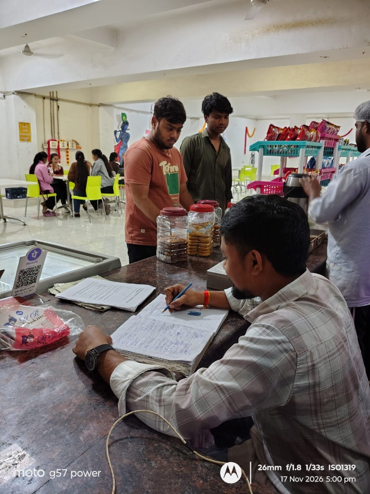
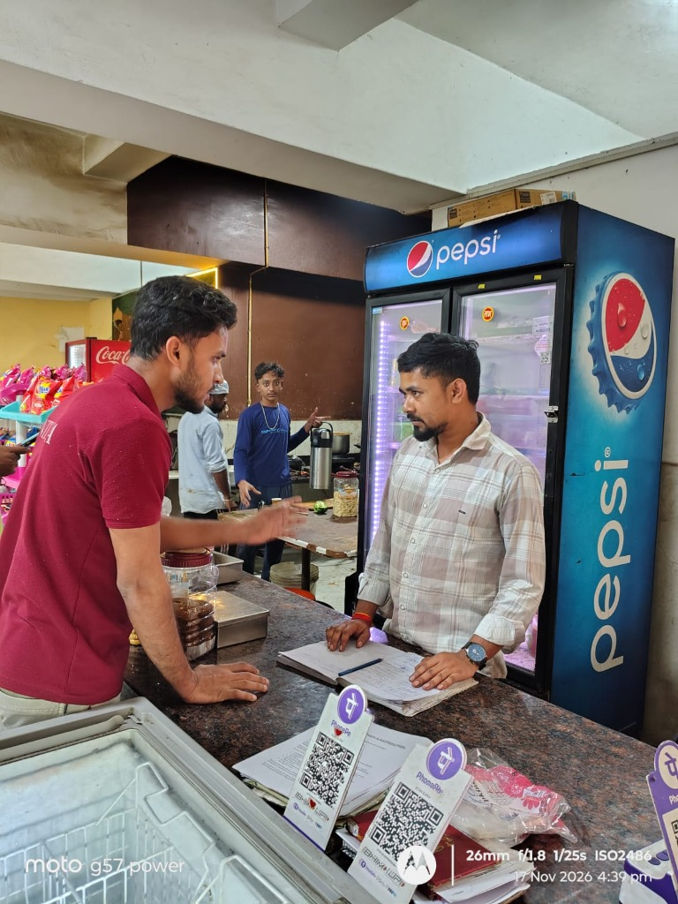

# Canteen Food Demand & Waste Tracker

A practical, data-driven software tool designed to help a campus canteen monitor customer demand, track unsold food quantities, and make informed daily preparation decisions to reduce food and financial waste.

---

## 📸 Fieldwork Evidence

The photographs below were captured during an on-site field visit to the campus canteen. They provide genuine evidence of the operational setting, counter setup, and handwritten ledger recording.

| Evidence 1: Physical Logging at Counter | Evidence 2: Ordering Counter & Interaction |
| :---: | :---: |
|  |  |
| *Staff managing daily transactions and notebook logging at the counter.* | *Customer counter and beverage cooling unit.* |

---

## 🎯 The Real-World Problem Statement

During an in-person field discussion, the canteen owner highlighted a critical daily dilemma:

> *"The canteen sometimes prepares more Biryani than the actual customer demand. When the demand is lower than expected, unsold Biryani gets spoiled, causing food waste and financial loss. The owner needs a simple way to understand previous demand and make better daily preparation decisions."*

### Key Realities Observed:
- **Perishability:** Prepared cooked meals like Biryani cannot be preserved overnight without significant quality deterioration and food safety risks.
- **Demand Fluctuation:** Daily student footfall varies depending on exam schedules, class timetables, and weekday vs. weekend patterns.
- **Menu Items & Pricing:**
  - **Biryani Half:** ₹90 per portion
  - **Biryani Full:** ₹150 per portion
  - **Chicken Roll:** ₹60 per piece

---

## 🎯 Project Objectives

1. **Understand Daily Demand:** Aggregate historical sales across menu items to establish baseline consumption patterns.
2. **Item Comparison:** Compare sales and demand between Biryani Half, Biryani Full, and Chicken Roll.
3. **Monitor Wastage:** Track daily remaining portions and identify peak over-preparation days without assuming all remaining food was immediately spoiled.
4. **Data-Driven Preparation Planning:** Provide daily preparation quantity guidance based on historical averages to minimize unnecessary food cooking.
5. **Beginner-Friendly & Maintainable:** Provide a clean, intuitive dashboard with zero enterprise bloat.

---

## 💡 Application Features

- **Executive Summary Dashboard:**
  - Displays Total Prepared (619 units), Total Sold (545 units), Total Remaining (74 units), and Unsold Rate (12.0%).
  - Reports Total Revenue generated across all recorded sales (₹52,620.00).
  - Breakdown cards for Biryani Half, Biryani Full, and Chicken Roll.
- **Food Demand Analysis:**
  - Side-by-side sales comparison across all menu items.
  - Identification of the top-selling item (**Biryani Half** with 217 portions sold, generating ₹19,530.00).
  - Multi-line sales trend chart and individual item-level bar charts (Prepared vs. Sold).
- **Food Waste Analysis:**
  - Stacked bar chart showing daily unsold portions over time.
  - Identification of peak surplus dates (e.g., 2026-11-09 with 13 unsold portions).
  - Transparent distinction between unsold stock at closing and confirmed spoiled food.
- **Preparation Planning:**
  - Calculates daily average sales:
    - Biryani Half: ~21.7 portions/day (Recommended daily prep: 22 portions)
    - Biryani Full: ~14.9 portions/day (Recommended daily prep: 15 portions)
    - Chicken Roll: ~17.9 units/day (Recommended daily prep: 18 portions)
  - Explicit disclaimers highlighting that estimates are statistical baselines, not guaranteed forecasts.
- **Data Management & Record Entry:**
  - Full tabular view of all 30 records from `data.csv`.
  - Built-in form to append new daily field observations directly to `data.csv`.
  - Automatic calculation of `Quantity_Remaining = Quantity_Prepared - Quantity_Sold`.
  - CSV export and custom CSV upload support.

---

## 🛠️ Technology Stack

- **Programming Language:** Python 3.10+
- **Application Framework:** Streamlit
- **Data Manipulation & Analysis:** Pandas
- **Visualization:** Matplotlib
- **Data Storage:** Flat CSV (`data.csv` / `Canteen_Record.csv`)

---

## ⚙️ Installation Instructions

1. **Clone or Download the Repository:**
   ```bash
   git clone <YOUR_GITHUB_REPOSITORY_URL>
   cd canteen-fieldwork-project
   ```

2. **Create and Activate a Virtual Environment:**
   ```bash
   # On Windows
   python -m venv venv
   .\venv\Scripts\activate

   # On macOS / Linux
   python3 -m venv venv
   source venv/bin/activate
   ```

3. **Install Required Packages:**
   ```bash
   pip install -r requirements.txt
   ```

---

## 🚀 How to Run the Project

Launch the application using Streamlit:
```bash
streamlit run app.py
```

The interactive dashboard will automatically open in your default browser at `http://localhost:8501`.

---

## 📊 Summary of Actual Collected Data (30 Records)

Based on the 30 consecutive canteen records provided (2026-11-01 to 2026-11-10):

| Metric | Biryani Half | Biryani Full | Chicken Roll | Overall Total |
| :--- | :---: | :---: | :---: | :---: |
| **Unit Selling Price** | ₹90 | ₹150 | ₹60 | — |
| **Total Quantity Prepared** | 249 portions | 174 portions | 196 units | **619 units** |
| **Total Quantity Sold** | 217 portions | 149 portions | 179 units | **545 units** |
| **Total Quantity Remaining** | 32 portions | 25 portions | 17 units | **74 units** |
| **Unsold Rate (%)** | 12.9% | 14.4% | 8.7% | **12.0%** |
| **Total Revenue Generated** | ₹19,530.00 | ₹22,350.00 | ₹10,740.00 | **₹52,620.00** |
| **Average Daily Sales** | 21.7 / day | 14.9 / day | 17.9 / day | **54.5 / day** |

---

## 🖼️ Application Screenshots

*(Screenshots of the working dashboard tabs can be placed in `assets/` and linked here)*

---

## ⚠️ Limitations

1. **Heuristic Estimates:** Preparation recommendations are statistical averages based on historical trends; they do not predict external events such as sudden college holidays, rainy days, or festival events.
2. **Remaining vs. Spoiled Food:** The system logs remaining unsold food at closing time. While Biryani carries a high risk of overnight spoilage, some portion of non-perishable ingredients or rolls might be managed differently by the kitchen.
3. **Dataset Scope:** The baseline dataset covers 10 operating days (30 records). While sufficient to demonstrate patterns, longer longitudinal tracking will yield more robust seasonal trends.

---

## 🔗 Project Links

- **GitHub Repository:** `[Insert GitHub Repository Link Here]`
- **3-Minute Demonstration Video:** `[Insert Video Demonstration Link Here]`
