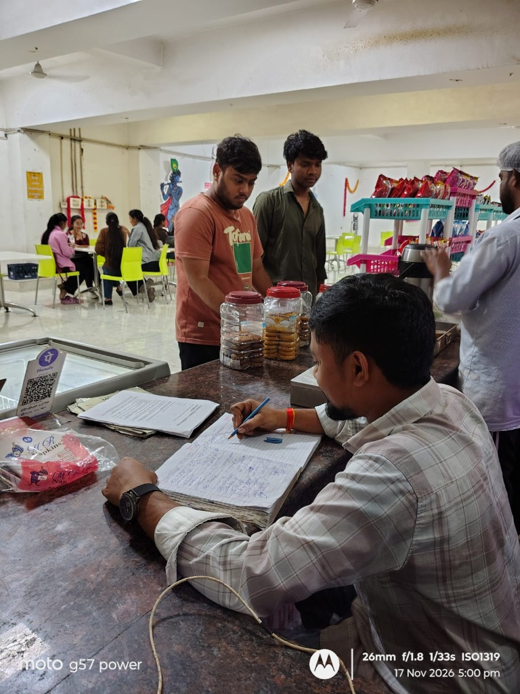

# Fieldwork Documentation & Interview Record

## 1. Field Visit Details
- **Student Name:** Mo Azruddin Khan
- **Visit Date:** 17 November 2026
- **Location:** Campus Canteen
- **Staff Member Interviewed:** Rahul
- **Role:** Canteen Counter Staff (manages customer orders, payments, and counter ledger)

---

## 2. Authentic Photographic Evidence
The photographs below were captured in-person during the on-site visit to the campus canteen. They are preserved byte-for-byte in the `assets/` directory without any modification, enhancement, or synthetic regeneration.

| Evidence Photo 1: Counter & Record Book | Evidence Photo 2: Counter Interaction & Cooler |
| :---: | :---: |
|  |  |
| *Rahul recording daily transactions and customer orders manually at the counter.* | *Canteen ordering counter and beverage cooler during operating hours.* |

---

## 3. Discussions with Canteen Counter Staff (Rahul)
During the in-person discussion at the canteen counter, Rahul explained the daily operational workflow and shared these confirmed points:

1. **High Popularity of Biryani:** Biryani is the most popular food item in the canteen and drives a substantial portion of customer demand.
2. **Over-Preparation Beyond Demand:** In the morning, the kitchen staff often prepare more Biryani portions than customers actually purchase during the day.
3. **Incomplete Daily Sales:** On multiple operating days, the prepared Biryani fails to sell out completely before closing time.
4. **Food Spoilage & Financial Loss:** Unsold Biryani has a short shelf life and cannot be safely preserved for long periods; when demand drops, leftover portions spoil, directly creating avoidable food wastage and monetary losses for the canteen.
5. **Secondary Focus Item (Chicken Roll):** Chicken Roll is another regular cooked food item served at the counter, which also requires balanced daily cooking decisions to avoid wastage.

### Confirmed Menu Prices:
- **Biryani Half:** ₹90 per portion
- **Biryani Full:** ₹150 per portion
- **Chicken Roll:** ₹60 per piece

---

## 4. Problem Statement Identified from Fieldwork
> *"The canteen sometimes prepares more Biryani than the actual customer demand. When the demand is lower than expected, unsold Biryani gets spoiled, causing food waste and financial loss. The owner needs a simple way to understand previous demand and make better daily preparation decisions."*

---

## 5. Field Observation
- **Surprising Operational Finding:** Despite Biryani being the single most popular and requested dish on the canteen menu, customer turnout fluctuates enough that notable quantities of prepared Biryani still end up unsold on slower days and risk immediate spoilage. Counter staff previously had no analytical mechanism to review past sales averages, causing daily morning cooking targets to rely entirely on guesswork.

---

## 6. Observation and Data Collection Methodology
- **On-Site Observation:** Direct observation at the counter during peak operating hours, examining student footfall, physical order placement, and the handwritten book-logging process conducted by Rahul.
- **Staff Interaction:** Structured conversation with Rahul at the counter regarding daily batch preparation schedules, evening inventory reconciliation, and unsold food disposal.
- **Operational Dataset:** 30 consecutive daily operational records covering 10 operating days (2026-11-01 to 2026-11-10) for Biryani Half, Biryani Full, and Chicken Roll.
- **Core Formula:**
  $$\text{Quantity\_Remaining} = \text{Quantity\_Prepared} - \text{Quantity\_Sold}$$
- **Data Attribution:** The records are analyzed as provided operational figures from the canteen to model demand variations and evaluate waste mitigation.
