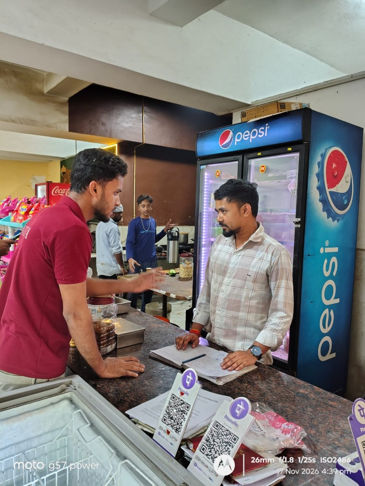

# Fieldwork Documentation & Interview Record

## 1. Field Visit Details
- **Student Name:** Mo Azruddin Khan
- **Visit Date:** 17 November 2026
- **Location:** Campus Canteen
- **Staff Member Interviewed:** Rahul
- **Role:** Canteen Counter Staff (manages orders and counter ledger)

---

## 2. Authentic Photographic Evidence
The photographs below were captured in-person during the on-site visit to the campus canteen. They are preserved byte-for-byte in the `assets/` directory without any modification, enhancement, or synthetic regeneration.

| Evidence Photo 1: Counter & Record Book | Evidence Photo 2: Counter Interaction & Cooler |
| :---: | :---: |
|  |  |
| *Rahul recording daily transactions and customer orders manually at the counter.* | *Canteen ordering counter and beverage cooler during operating hours.* |

---

## 3. Discussions with Canteen Counter Staff (Rahul)
During the in-person discussion at the canteen counter, Rahul explained the daily operational workflow and shared these confirmed points:

1. **High Popularity of Biryani:** Biryani is the most popular food item in the canteen and drives a substantial portion of customer demand.
2. **Over-Preparation Beyond Demand:** In the morning, the kitchen sometimes prepares more Biryani than customers actually purchase during the day.
3. **Incomplete Daily Sales:** On some operating days, the prepared Biryani does not sell out completely.
4. **Food Spoilage & Financial Loss:** Unsold Biryani has a short shelf life and cannot be carried over indefinitely; when demand drops, leftover portions spoil, resulting directly in food wastage and financial loss for the canteen.
5. **Secondary Focus Item (Chicken Roll):** Chicken Roll is another regular prepared food item served at the counter, also requiring balanced daily cooking decisions.

### Confirmed Menu Prices:
- **Biryani Half:** ₹90 per portion
- **Biryani Full:** ₹150 per portion
- **Chicken Roll:** ₹60 per piece

---

## 4. Problem Statement Identified from Fieldwork
> *"The canteen sometimes prepares more Biryani than the actual customer demand. When the demand is lower than expected, unsold Biryani gets spoiled, causing food waste and financial loss. The owner needs a simple way to understand previous demand and make better daily preparation decisions."*

---

## 5. Field Observation
- **Surprising Operational Finding:** Despite Biryani being the single most popular dish on the menu, daily customer turnout varies sufficiently that substantial quantities of prepared Biryani still end up unsold on slower days and risk immediate spoilage. Without historical sales tracking at the counter, morning preparation quantities relied on guesswork rather than data.

---

## 6. Observation and Data Collection Methodology
- **On-Site Observation:** Direct counter observation of student footfall, physical ordering, and manual book logging by counter staff.
- **Staff Interaction:** Structured conversation with Rahul at the counter regarding daily batch preparation and evening unsold stock handling.
- **Operational Dataset:** 30 consecutive daily operational records covering 10 operating days (2026-11-01 to 2026-11-10) for Biryani Half, Biryani Full, and Chicken Roll.
- **Core Formula:**
  $$\text{Quantity\_Remaining} = \text{Quantity\_Prepared} - \text{Quantity\_Sold}$$
- **Data Attribution:** The records are analyzed as provided operational figures from the canteen to model demand variations and evaluate waste mitigation.
